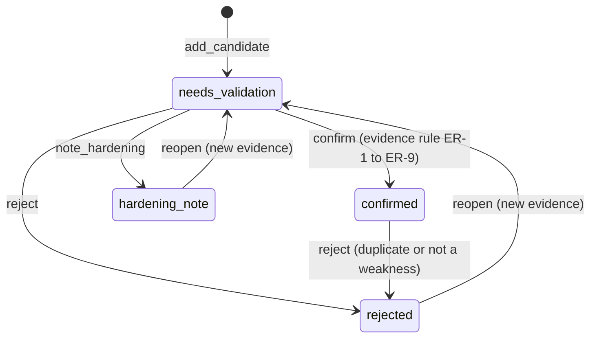
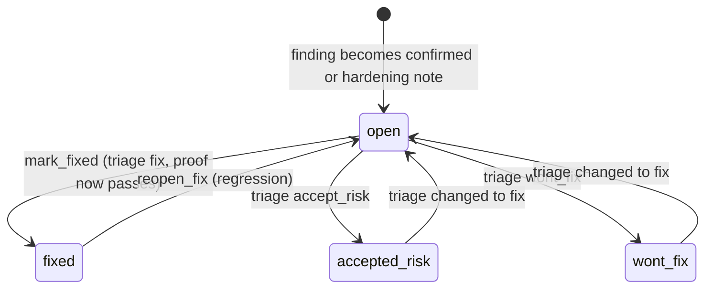
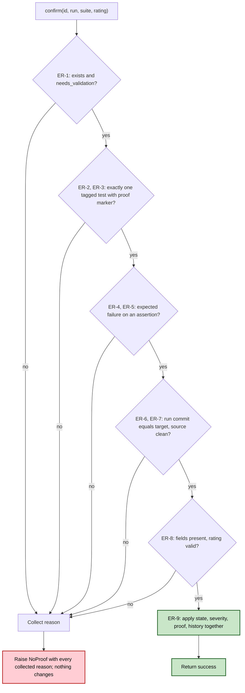
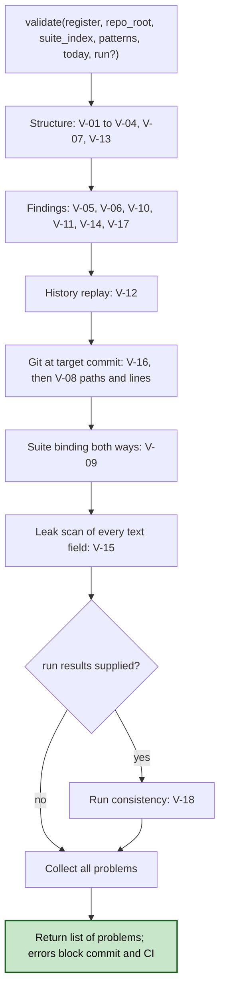
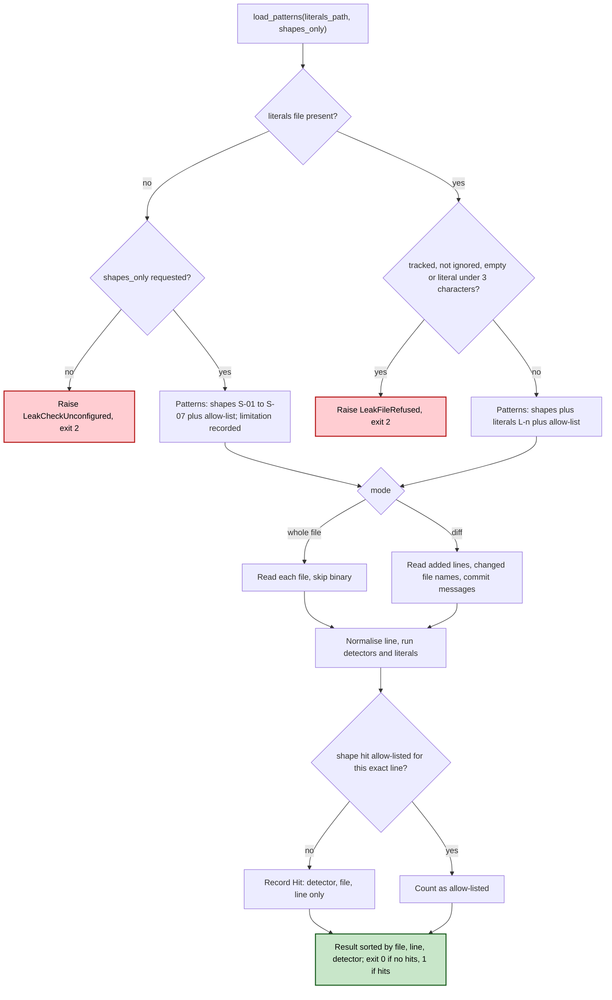

# U0 Evidence Core — Business Logic Model

Unit: U0 Evidence core. Entities: `domain-entities.md`. Rules (the numbered ids used below): `business-rules.md`.
Technology-agnostic: this file describes what happens and in what order. Every example is synthetic. Five diagrams,
each validated and each followed by a text alternative.

## 1. Life of a finding

A candidate enters from any source (a code-audit hunter, a scanner, a Track B test, or me by hand). It leaves
`needs_validation` only through a rule-checked move.



### Text alternative

```
(new)            --add_candidate-->  needs_validation
needs_validation --confirm-------->  confirmed        (only if the evidence rule holds)
needs_validation --reject--------->  rejected
needs_validation --note_hardening->  hardening_note
rejected         --reopen--------->  needs_validation (new evidence recorded)
hardening_note   --reopen--------->  needs_validation (new evidence recorded)
confirmed        --reject--------->  rejected         (kind: duplicate or not a weakness only)
Every other move is refused with IllegalMove. Nothing is ever deleted.
```

### Fix status (confirmed findings and hardening notes only)



### Text alternative

```
(confirmed or hardening note) -> open
open          --mark_fixed (owner triage = fix; for confirmed, the proof test now passes)--> fixed
open          --owner triage accept_risk--> accepted_risk
open          --owner triage wont_fix-----> wont_fix
fixed         --reopen_fix (regression)---> open
accepted_risk --owner changes triage to fix--> open
wont_fix      --owner changes triage to fix--> open
(A change between accepted_risk and wont_fix is a new triage decision, recorded the same way.)
A fixed finding stays "confirmed" in state; its history shows it was fixed and when.
```

## 2. Operation: confirm

The only road to `confirmed`. All conditions are checked first and every unmet one is reported together; if all hold,
the change is applied in one step (RG-5, ER-9).



(The flowchart shows the first failing check leading to the refusal for readability. In operation every check is
evaluated and all unmet reasons are collected before raising.)

### Text alternative

```
1. The finding exists and is needs_validation.                     (ER-1)
2. The suite has exactly one test tagged with the id, and it
   carries the strict assertion-only expected-failure marker.      (ER-2, ER-3)
3. The run lists that test as an expected failure caused by an
   assertion (not an unexpected pass, skip, error or absence).     (ER-4, ER-5)
4. The run tested the register's target commit, with clean source. (ER-6, ER-7)
5. Attacker, boundary, impact, fix and affected file exist and the
   rating is valid (table lookup, or a hand rating with a reason). (ER-8)
Any "no": NoProof lists every unmet condition; nothing is changed.
All "yes": state, severity, rating, proof, checked_by, fix status and
two history entries are written together.                          (ER-9)
```

Worked example (synthetic). Hunter `W-03` raises a candidate: a request by a neighbour with no credentials can read a
list that should need a token. The register adds `PT-001` as `needs_validation`. I write a suite test that asserts
the secure behaviour (the request is refused) and tag it `PT-001`; it carries the strict marker, and a run on the
tested commit reports it as an expected failure on an assertion. `confirm("PT-001", run, suite, rating)` with
capability `read_financial_data` and the default precondition `network_reach_only` gives `high` from the table.
`PT-001` is now `confirmed`, `open`, severity `high`. The validator will refuse to pass the register (V-10) until I
record the day I told the owner in chat; only then can it be committed.

## 3. Operation: validate

`validate` is read-only and total: it runs every rule group and returns **all** problems.



### Text alternative

```
validate(register, repo_root, suite_index, patterns, today, run?)
  1. Structure and limits (V-01 to V-04), severity basis (V-07), dates (V-13)
  2. Per-finding rules (V-05, V-06, V-10, V-11, V-14) and possible duplicates (V-17)
  3. History replay reproduces the current values (V-12)
  4. Read git at the target commit: target exists (V-16), then every cited path and line range (V-08)
  5. Suite binding in both directions (V-09)
  6. Leak scan of every text field (V-15)
  7. If run results were given: run consistency (V-18)
  8. Return every problem; any error blocks the commit and CI
```

Order matters in one place only: if the target commit cannot be read (V-16), V-08 is skipped and that single cause
is reported once, instead of one problem per finding.

## 4. Operation: save and load

**Load.** Read the file; refuse a missing, malformed or newer-schema file with a typed error that names no content
(RG-1). Loading changes nothing on disk.

**Save** (RG-2, RG-3):

1. Serialise canonically (fixed key order, two-space indent, UTF-8, LF, trailing newline).
2. Leak-scan the whole serialised text. A hit raises `LeakDetected`; nothing is written.
3. Write the text to a temporary file in the same directory and flush it to disk.
4. Replace the real file with the temporary one in a single step.
5. A crash before step 4 leaves the old register; after it, the new one. Never a half-written file.

Saving does **not** require the register to be valid. A register with an error (for example a high finding awaiting
the owner notice) can be saved while work continues; the error blocks the commit and CI, not the save.

## 5. Operation: funnel

Computed from the register on demand, no state kept (FN-1):

1. Count records by state, by source, and (confirmed only) by severity.
2. Count rejected records by reason kind; count confirmed and hardening records by fix status.
3. Count hand-rated findings, high or critical findings with no owner notice, and `needs_validation` records by source.
4. Check the invariants (FN-2). If any fails, the register is inconsistent and the funnel reports that instead of numbers.

## 6. Operation: leak check



### Text alternative

```
Configure:
  literals file absent  -> refuse (exit 2), unless shapes_only was asked for; then continue with
                           shapes only and carry the limitation "literals were not checked".
  literals file present -> refuse (exit 2) if git tracks it, git does not ignore it, it holds no
                           literal, or a literal is under 3 characters; otherwise load shapes + literals.
Scan, by mode:
  whole file: read each file under the given paths, skipping binary files.
  diff:       read only the lines the change adds, the names of the changed files, and (for a range)
              the messages of the commits in it.
For each line: normalise (NFKC), run the shape detectors and the literals.
  A shape hit whose (detector, file, exact line) is in the allow-list is counted, not reported.
  Any other hit is recorded as (detector or literal number, file, line). The matched text is never kept.
Result: hits sorted by file, line, detector. Exit 0 clean, 1 hits, 2 not configured or refused.
```

### Why two modes

The pen-test files (`pentest/`, the register, the report, the pen-test documents) are owned by this effort, so the
whole file is scanned. `audit.md` and `aidlc-state.md` carry the history of every other piece of work in the
project, so a whole-file scan would raise alarms about things this effort did not write and cannot fix. Diff mode
scans only what a change adds. This is what my hand-run scan before each push already does; the tool makes it
repeatable and testable.

## 7. Operation: provisioning the local literals file (Code Generation, Q2 = B)

1. Add `pentest/.local/` to `.gitignore`; confirm with `git check-ignore` (LP-1).
2. Create the file, owner-only permissions, from the values my pre-push scan uses, without echoing them; report only
   the number of lines written (LP-2).
3. Run the check in whole-file mode over `pentest/` and the register (both empty or nearly so) and in diff mode over
   the unit's commits; the expected result is clean (LP-4).
4. Hand the file to the owner: it is theirs to edit (LP-3).

## 8. Changes this stage makes to the approved component methods

`component-methods.md` says names and signatures "may be refined in Functional Design without changing the design".
These refinements follow from the rules; none changes a component, a dependency or a unit boundary. A one-paragraph
pointer is added at the end of `component-methods.md`.

| Method (as approved) | Refined to | Why |
|---|---|---|
| `Candidate(source, title, attacker, boundary, paths, evidence)` | `attacker` and `boundary` optional | A scanner candidate does not know them; `confirm` requires them (ER-8). |
| `add_candidate(c) -> str` | `-> AddResult(id, created)` | Idempotent add (RG-4) must tell the caller nothing new was added. |
| `confirm(id, run, severity)` | `confirm(id, run, suite, rating, attacker?, boundary?)` | The test is found through the suite index tag (ER-2); the severity comes from a `SeverityRating` (SV-2), not a typed word. |
| `reject(id, reason)` | `reject(id, kind, reason, checked_by)` | Funnel counts rejections by kind; PT-NFR-5 independence (V-14). |
| `note_hardening(id, text)` | `note_hardening(id, recommended_fix, reason)` | A hardening note needs a recommended fix (V-04). |
| (none) | `reopen`, `rerate`, `record_triage`, `mark_fixed`, `reopen_fix` | Needed by SM-2, SV-6, FX-2 to FX-4. |
| `Register.save(path)` | `save(path, patterns)` | Save leak-scans the serialised text (RG-3). |
| `Validator.validate(reg, repo_root, suite_index)` | adds `patterns`, `today`, optional `run` | V-15 needs patterns, V-10 and V-13 need the date, V-18 needs the run. |
| `Leak Check: scan(paths, patterns)` | `scan_files(paths, patterns)`, `scan_added_lines(spec, patterns)`, `scan_text(label, text, patterns)`, `check_allowlist(...)` | The two modes (LK-5, LK-6), in-memory register text (RG-3, V-15), stale allow-list entries (LK-7). |
| `load_patterns(path)` | `load_patterns(path, shapes_only=False)` | LK-1. |

## 9. Validation against the requirements

| Requirement | Satisfied by | Gap |
|---|---|---|
| PT-FR-7: record fields | `domain-entities.md` section 4 lists identifier, title, state, attacker, boundary, evidence, proof, affected files, impact, recommended fix and fix status, plus source, triage and the owner-notice date | none |
| PT-FR-7: severity only on `confirmed`, by impact given the attacker | SV-1; the table (Q1 A) takes capability and precondition, and the precondition is tied to the attacker class (SV-4) | none |
| PT-FR-7: hardening notes for missing best practices | SM-2 (`note_hardening`), V-04; kept out of the severity table | none |
| PT-FR-7: proof asserts secure behaviour, fails on unmodified code, strict expected failure, fix noticed, regression red | ER-3 to ER-7, FX-3 to FX-5, V-09, V-18 | the strict marker itself is created in U2 (suite); U0 checks it through `proof_marker` |
| PT-NFR-1: no real data in the repository | RG-3, LK-1 to LK-12, S-01 to S-07, V-15, LP-1 to LP-5; the register has no field for captured data (domain invariants) | CI runs shapes only (stated as a limitation by LK-1, LK-10) |
| PT-NFR-5: evidence quality, independent verifier, defence-in-depth apart, funnel | ER-1 to ER-9, V-14, the hardening-note state, FN-1 to FN-4 | the rule proves the test fails on an assertion, not that the assertion is right; stated in the evidence rule |
| PT-NFR-6: maintainability | the test obligation (a test per rule id); a separate project with its own dependency file (code organisation in the unit definition) | the layout is settled in the Code Generation plan |
| PT-NFR-7: A2 disclosure order | ON-1, ON-2, V-10, SV-6 | the notice to the owner itself is my process step; the code records its date and refuses to let the register pass without it |
| Unit definition of done: "the Validator rejects each way a record can be wrong (a test per rule); `confirm()` refuses without a proof run; the Leak Check never prints matched text" | the test obligation; ER-1 to ER-8; LK-4 and LK-12 | none |

Decided later, in the Code Generation plan: the library for the schema (and whether `schema.json` is generated from
the typed models), the layout of `pentest/src/pentest/` and `pentest/tests/`, how the git reads in V-08 and V-16 are
made (and that the CI checkout must include full history so the target commit is present), creating `uv.lock` (uv is
not installed here; it would go into a project environment, a download I will state first), the default scan scope
paths, and the `.github/workflows/test-pentest.yml` content.

Open items for the owner at the approval: none. Two design additions beyond the plan's twelve decisions are marked
for your review: the credential-shaped detector S-07 (rules section 9.1) and the scanning of file names and commit
messages in diff mode (LK-6).
