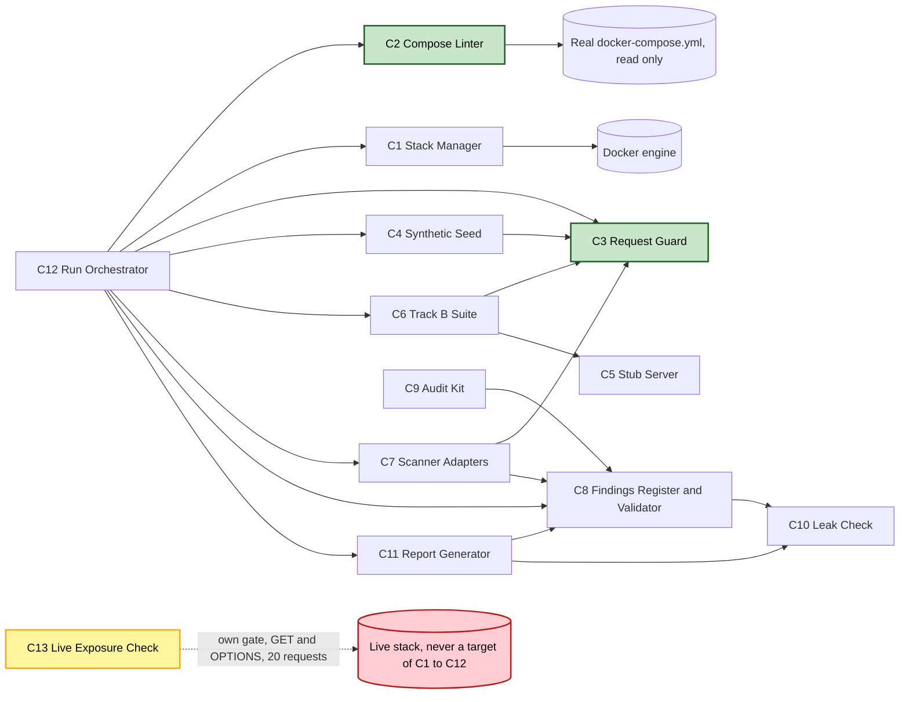
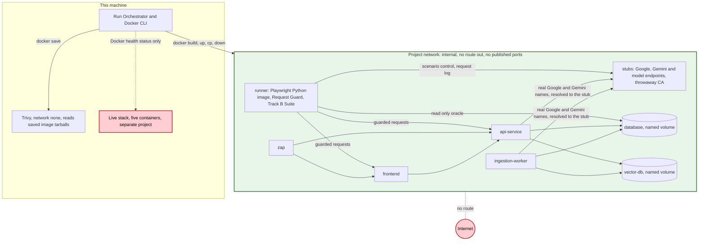

# Penetration Test — Component Dependencies and Communication

## Dependency matrix

Rows depend on columns. `●` = uses at run time; `○` = reads files or output only. Blank = no dependency.

| Component \ depends on | C1 Stack | C2 Linter | C3 Guard | C4 Seed | C5 Stubs | C6 Suite | C7 Scanners | C8 Register | C9 Audit | C10 Leak | C11 Report |
|---|---|---|---|---|---|---|---|---|---|---|---|
| C1 Stack Manager | | | | | | | | | | | |
| C2 Compose Linter | | | | | | | | | | | |
| C3 Request Guard | | ○ (live identity) | | | | | | | | | |
| C4 Synthetic Seed | | | ● | | | | | | | | |
| C5 Stub Server | | | | | | | | | | | |
| C6 Track B Suite | | | ● | | ● | | | ○ (finding ids) | | | |
| C7 Scanner Adapters | ○ (images) | | ● | | | | | | | | |
| C8 Register + Validator | | | | | | ○ (suite index) | | | | ● | |
| C9 Audit Kit | | | | | | | | ● | | | |
| C10 Leak Check | | | | | | | | | | | |
| C11 Report Generator | | | | | | | | ● | ○ (ledger) | ● | |
| C12 Run Orchestrator | ● | ● | ● | ● | ○ | ● | ● | ● | ○ | ● | ● |
| C13 Live Exposure Check | | | | | | | | | | | |

C13 is deliberately an empty row and column: it shares no code path with the Request Guard or the Stack Manager (D13).

External dependencies:

| Component | External thing | How | Direction |
|---|---|---|---|
| C1 | Docker engine | `docker` command line | host to engine |
| C2 | repository `docker-compose.yml` | read file | read only |
| C4 | `transactagent_db` models | Python import (same repository) | read only |
| C5 | none outside the project | | |
| C6 | the product's API, frontend, database (throwaway copies) | HTTP and a read-only database connection, through C3 | runner to stack |
| C7 | ZAP and Trivy images; Trivy's vulnerability database | pinned images; database download is a separate announced step | host pulls once |
| C13 | the live stack | GET and OPTIONS only | host to live |

## Component diagram (validated)



### Text alternative

```
Run Orchestrator (C12) calls: Compose Linter (C2), Stack Manager (C1), Request Guard (C3), Synthetic Seed (C4),
  Track B Suite (C6), Scanner Adapters (C7), Findings Register (C8), Report Generator (C11).
Stack Manager (C1)  -> Docker engine.
Compose Linter (C2) -> the repository's own docker-compose.yml (read only).
Synthetic Seed (C4), Track B Suite (C6), Scanner Adapters (C7) -> Request Guard (C3).
Track B Suite (C6)  -> Stub Server (C5) control interface.
Scanner Adapters (C7), Audit Kit (C9) -> Findings Register (C8).
Findings Register (C8) and Report Generator (C11) -> Leak Check (C10); Report Generator also reads the register.
Live Exposure Check (C13) -> the live stack, through its own gate only (dotted: separate from everything above).
```

## Runtime topology (validated)



### Text alternative

```
Inside the project network (internal, no route out, nothing published to the host):
  runner (Request Guard + Track B Suite) -> frontend, api-service (guarded), stubs (control), database (read only)
  zap -> api-service, frontend
  frontend -> api-service
  api-service -> database, vector-db, stubs (the real Google and Gemini names resolve to the stub)
  ingestion-worker -> database, vector-db, stubs (same)
There is no route from the project network to the internet.
On the host:
  Run Orchestrator / Docker CLI -> project (build, up, copy results out, down); -> Trivy (saved image tarballs);
  -> live stack (Docker health status of the five containers only, local runs only; the application is not contacted).
  Trivy runs with no network at all.
```

## Communication patterns

| Pattern | Where | Notes |
|---|---|---|
| Docker command line, synchronous | C1, C7 (container start), C12 | One subprocess per action; every call has a timeout. |
| HTTP over the internal network, by service name | runner to API and frontend; ZAP to API and frontend; browser to frontend | Every request from the runner goes through C3; ZAP is pointed at service names only. |
| HTTPS to the stub under the real Google and Gemini names | API and worker to C5 | Trusted through the throwaway authority's certificate (`SSL_CERT_FILE` and the equivalents for each library). Which libraries honour it is decided by the U1 spike. |
| Plain HTTP control interface | runner to C5 | Select the reply for a test; read what the application sent. |
| Read-only database connection | runner to the throwaway database | Used as an oracle in tests; refused by C3 unless the marker is present. |
| Files | Linter reads the repository's compose file; Audit Kit writes work packages and reads candidate files; Register and Report write under `aidlc-docs/construction/pentest/` | No file is mounted into a container: code goes in by building the images, results come out by copying from the finished runner. |
| Named volumes | the CA volume (stub writes, API, worker and runner read); database and vector-db data | Removed at teardown; `leftovers()` proves it. |

## Design constraints checked against the dependencies

- **No route out:** the only networks are the project's internal one and Trivy's `none`. The Linter refuses any
  other. The Isolation phase proves it again at run time.
- **No dependency on the live stack's data or secrets:** the Linter learns the live identity from the repository's
  own compose file. The live `.env` and the running application are never read; the one live look is Docker's health
  status for the five live containers, and only on a local run (Q3).
- **One-way dependencies, no cycles:** Orchestrator depends on everything; the Register depends only on the Leak
  Check and the suite index; the Guard depends only on the live identity. No component depends on the Orchestrator.
- **The live check cannot be weakened by the throwaway harness, nor the reverse:** C13 shares nothing with C1 to C12.
