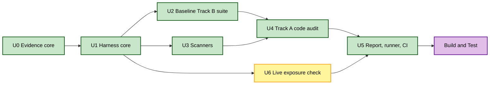

# Penetration Test — Unit of Work Dependencies

## Dependency matrix

Rows depend on columns. `●` = direct dependency on that unit's code; `○` = transitive only.

| Unit \ depends on | U0 | U1 | U2 | U3 | U6 | U4 | U5 |
|---|---|---|---|---|---|---|---|
| U0 Evidence core | | | | | | | |
| U1 Harness core | ● | | | | | | |
| U2 Baseline suite | ● | ● | | | | | |
| U3 Scanners | ● | ● | | | | | |
| U6 Live exposure check | ○ | ● (guard tested first) | | | | | |
| U4 Code audit | ● | ● | ● | ● | | | |
| U5 Report, runner, CI | ● | ● | ● | ● | ● | ● | |

No cycles. U0 has no dependencies; U5 depends on everything; no unit depends on U5.

## Order and why

**U0, U1, U2, U3, U6, U4, U5**, then Build and Test.

| Step | Why here |
|---|---|
| U0 first | Pure Python, no Docker, no risk; gives every later unit a place to record findings and the leak check. |
| U1 second | Nothing can be tested until the throwaway stack and both guards exist and are proven. |
| U2 and U3 | Independent of each other (both need U1 and U0). U2 first because the baseline suite is the part most likely to find something and the register is ready for it. |
| U6 after U3 | The live check needs only the guard tested (U1). It is placed late so the single run happens once the rest of the harness is trusted, and it is announced first. |
| U4 after U2, U3 | The audit's proofs are tests in the suite, so the suite and the scanner candidates must exist; waves benefit from knowing what the baseline already covers. |
| U5 last | Needs everything to put in the report and the one command. |

## Unit diagram (validated)



### Text alternative

```
U0 Evidence core -> U1 Harness core
U1 Harness core  -> U2 Baseline Track B suite, U3 Scanners, U6 Live exposure check
U2 and U3        -> U4 Track A code audit
U4 and U6        -> U5 Report, runner, CI
U5               -> Build and Test
(Delivery order is the stack of branches: U0, U1, U2, U3, U6, U4, U5. U2, U3 and U6 do not depend on each other.)
```

## What each unit hands to the next

| From | To | Handed over |
|---|---|---|
| U0 | all | `Register`, `Validator`, `Leak Check`, shared types, the `test-pentest.yml` CI |
| U1 | U2, U3, U4, U5, U6 | a working throwaway stack and runner; `Guard` and `Linter`; the stub control interface; the seed; the orchestrator's first phases; the list of libraries that honour the certificate setting |
| U2 | U4, U5 | the suite, its fixtures, the `finding` marker and catalogue; the orchestrator's suite phase; any baseline findings in the register |
| U3 | U4, U5 | scanner runners and normaliser; the orchestrator's scanner and normalise phases; scanner candidates in the register |
| U6 | U5 | the live exposure result (summarised, no real addresses) |
| U4 | U5 | populated register and ledger; proof tests in the suite; the budget report |
| U5 | Build and Test | the report generator, the full one command, `pentest.yml` |

## Shared resources and integration points

| Resource | Who uses it | Rule |
|---|---|---|
| `aidlc-docs/construction/pentest/findings.json` | U0 defines; U2, U3, U4 write; U5 reads | Written only through `Register`; every write passes the Validator and the Leak Check. |
| Throwaway stack (one compose project) | U1 creates; U2, U3, U4 use through the runner | One run at a time on this machine; torn down after every run. |
| The one command | U1 creates; U2, U3, U4, U5 add phases | Each unit leaves it working for the phases that exist. |
| The live stack | U1 (Docker health status only, local runs); U6 (GET and OPTIONS, 20 requests) | Nothing else touches it. |

## Integration check points (carried into Build and Test)

1. U1 to U2: the guard refuses every live name and port **before** the first suite request.
2. U2 to U4: every confirmed finding's proof is a marked strict expected failure; the Validator checks both directions.
3. U3 to U0: scanner candidates are only ever `needs_validation`.
4. U6 to U1: the live check's tests and the guard's tests both pass before the live run.
5. U5 to all: the report's leak check passes; two consecutive full runs agree.
