# Penetration Test — Execution Plan

Status: **approved 2026-11-17 ("Approved.")** at the Workflow Planning gate. Requirements were approved
2026-11-17 ("ok approved."), which also confirmed assumptions A1 to A6 of `penetration-test-requirements.md`.

## Detailed analysis summary

### Transformation scope (brownfield)
- **Transformation type:** addition only. A new top-level directory `pentest/` (its own project), one new
  hand-started GitHub Actions workflow, and records under `aidlc-docs/`. No existing application code,
  schema, API, image or compose file is changed by building the test.
- **Primary changes:** the throwaway stack, synthetic seed, stubs and safety guard; the Track B suite; the
  scanner runners and normaliser; the Track A audit procedure, validator and register; the report generator,
  one-command runner and CI workflow; the live exposure check.
- **Related components:** all four existing units are *targets*, not change sites (Database, API Service,
  Ingestion Worker, Frontend SPA), plus `docker-compose.yml`, the three Dockerfiles, `frontend/nginx.conf`
  and `deploy/helm` as inputs to the audit.

### Change impact assessment
- **User-facing changes:** No. Nothing the owner sees in the application changes.
- **Structural changes:** Yes, additive: a new `pentest/` project. It reuses the project's existing test
  tooling (pytest, httpx, Playwright) and adds a dependency file of its own.
- **Data model changes:** No. The throwaway stack runs the real migrations from empty.
- **API changes:** No.
- **NFR impact:** Yes. Security is the subject; isolation, bounded effort and reproducibility are the
  constraints (PT-NFR-1 to PT-NFR-8).
- **Later effect:** the fix stage (not part of this plan) may change product code; it gets its own plan.

### Component relationships
- **Primary component:** `pentest/` (new).
- **Targets (read, run, never modified):** API Service, Ingestion Worker, Frontend SPA, Database, compose
  definition, Dockerfiles, nginx configuration, Helm chart.
- **Shared:** the real migrations (`database/`), the OpenAPI document served by the API.
- **Supporting:** `.github/workflows/pentest.yml` (new), `aidlc-docs/construction/pentest/` (reports).
- Change type for every existing component: **none**. Change priority: not applicable.

### Risk assessment
- **Risk level: High.** The live application holds real bank data and is reachable from the internet over a
  VPN; the earlier isolated-copy incident shows that a careless second stack can hurt the live database;
  sub-agents and third-party scanner images are involved; findings are published in a public repository.
- **Rollback complexity: Easy.** Everything is additive and in its own directory; reverting is deleting it.
  The throwaway stack leaves nothing behind (volumes removed on teardown).
- **Testing complexity: Complex.** The test itself needs tests: the guard, the seed, the stubs, the
  normaliser and the validator each have their own, and the isolation claim is proven by a test.

## Phase determination

| Stage | Decision | Rationale |
|---|---|---|
| Workspace Detection | Completed | Existing state resumed. |
| Requirements Analysis | Completed, approved | `penetration-test-requirements.md`. |
| User Stories | **SKIP** | One persona (the owner), no user-facing feature, acceptance criteria are already the PT-FR and PT-NFR items. |
| Workflow Planning | This document | |
| Application Design | **EXECUTE** (standard depth) | New components with real interfaces to settle before code: stack manager, safety guard, seed, stubs, test catalogue, scanner adapters, findings register and validator, report generator, live exposure check. |
| Units Generation | **EXECUTE** (standard depth) | Six units with dependencies (below). |
| Functional Design | **EXECUTE** for U1, U2, U3, U4; **SKIP** for U5, U6 | Guard rules and seed (U1), the test catalogue and caps (U2), the normaliser mapping (U3) and the register schema and audit procedure (U4) are business-rule heavy. U5 and U6 are thin wrappers over those. |
| NFR Requirements | **SKIP** | Already specified in PT-NFR-1 to PT-NFR-8; the technology stack is fixed (Python, pytest, httpx, Playwright, Docker, pinned scanner images). |
| NFR Design | **SKIP** | Follows NFR Requirements. The isolation, caps and egress proof are designed inside U1 and U2. |
| Infrastructure Design | **EXECUTE** for U1, U3, U5; **SKIP** for U2, U4, U6 | U1: compose project, internal network, named volumes, no published ports (amended 2026-11-22; the hazard-prone part). U3: scanner images, pinned by digest, attached to the internal network. U5: the hand-started CI workflow. |
| Code Generation | **EXECUTE** for all six units | Always. For U4 the "code" is the audit procedure, the register validator and the proof tests; the audit itself is run as part of the unit. |
| Build and Test | **EXECUTE** | Always: run the guard tests, the suite, the scanners and the validator from a clean checkout; one full end-to-end run and one run in CI. |
| Operations | Placeholder | |

## Workflow visualization

### Mermaid diagram (validated)

```mermaid
flowchart TD
    Start(["Pen test request"])

    subgraph INCEPTION["INCEPTION PHASE"]
        WD["Workspace Detection<br/><b>COMPLETED</b>"]
        RA["Requirements Analysis<br/><b>COMPLETED</b>"]
        US["User Stories<br/><b>SKIP</b>"]
        WP["Workflow Planning<br/><b>COMPLETED</b>"]
        AD["Application Design<br/><b>EXECUTE</b>"]
        UG["Units Generation<br/><b>EXECUTE</b>"]
    end

    subgraph CONSTRUCTION["CONSTRUCTION PHASE - per unit, in this order"]
        U1["U1 Harness core<br/>stack, seed, stubs, guard"]
        U2["U2 Baseline Track B suite"]
        U3["U3 Scanners and normaliser"]
        U6["U6 Live exposure check"]
        U4["U4 Track A code audit<br/>sub-agents, capped"]
        U5["U5 Report, runner, CI"]
        BT["Build and Test<br/><b>EXECUTE</b>"]
    end

    subgraph OPERATIONS["OPERATIONS PHASE"]
        OPS["Operations<br/><b>PLACEHOLDER</b>"]
    end

    Start --> WD
    WD --> RA
    RA --> US
    US --> WP
    WP --> AD
    AD --> UG
    UG --> U1
    U1 --> U2
    U2 --> U3
    U3 --> U6
    U6 --> U4
    U4 --> U5
    U5 --> BT
    BT --> OPS
    OPS --> End(["Complete"])

    style WD fill:#4CAF50,stroke:#1B5E20,stroke-width:3px,color:#fff
    style RA fill:#4CAF50,stroke:#1B5E20,stroke-width:3px,color:#fff
    style WP fill:#4CAF50,stroke:#1B5E20,stroke-width:3px,color:#fff
    style US fill:#BDBDBD,stroke:#424242,stroke-width:2px,stroke-dasharray: 5 5,color:#000
    style AD fill:#FFA726,stroke:#E65100,stroke-width:3px,stroke-dasharray: 5 5,color:#000
    style UG fill:#FFA726,stroke:#E65100,stroke-width:3px,stroke-dasharray: 5 5,color:#000
    style U1 fill:#4CAF50,stroke:#1B5E20,stroke-width:3px,color:#fff
    style U2 fill:#4CAF50,stroke:#1B5E20,stroke-width:3px,color:#fff
    style U3 fill:#4CAF50,stroke:#1B5E20,stroke-width:3px,color:#fff
    style U4 fill:#4CAF50,stroke:#1B5E20,stroke-width:3px,color:#fff
    style U5 fill:#4CAF50,stroke:#1B5E20,stroke-width:3px,color:#fff
    style U6 fill:#4CAF50,stroke:#1B5E20,stroke-width:3px,color:#fff
    style BT fill:#4CAF50,stroke:#1B5E20,stroke-width:3px,color:#fff
    style OPS fill:#FFF59D,stroke:#F9A825,stroke-width:2px,color:#000
    style Start fill:#CE93D8,stroke:#6A1B9A,stroke-width:3px,color:#000
    style End fill:#CE93D8,stroke:#6A1B9A,stroke-width:3px,color:#000

    linkStyle default stroke:#333,stroke-width:2px
```



### Text alternative

```
INCEPTION
  Workspace Detection ........ COMPLETED
  Requirements Analysis ...... COMPLETED (approved 2026-11-17)
  User Stories ............... SKIP
  Workflow Planning .......... COMPLETED (approved 2026-11-17)
  Application Design ......... EXECUTE
  Units Generation ........... EXECUTE
CONSTRUCTION (each unit finished, with its own pull request, before the next)
  U1 Harness core ............ FD, Infra Design, Code Generation
  U2 Baseline Track B suite .. FD, Code Generation
  U3 Scanners, normaliser .... FD, Infra Design, Code Generation
  U6 Live exposure check ..... Code Generation, then one run
  U4 Track A code audit ...... FD, Code Generation (audit run, capped sub-agents)
  U5 Report, runner, CI ...... Infra Design, Code Generation
  Build and Test ............. EXECUTE
OPERATIONS
  Operations ................. PLACEHOLDER
```

## Phases to execute

### INCEPTION PHASE
- [x] Workspace Detection (COMPLETED)
- [x] Reverse Engineering (SKIPPED: existing documentation in `aidlc-docs/` is current)
- [x] Requirements Analysis (COMPLETED, approved 2026-11-17)
- [x] User Stories (SKIPPED)
- [x] Execution Plan (COMPLETED, approved 2026-11-17)
- [x] Application Design - EXECUTE (COMPLETED, approved 2026-11-22)
  - **Rationale:** new components and interfaces to settle before any code.
- [ ] Units Generation - EXECUTE
  - **Rationale:** six units with dependencies and an order.

### CONSTRUCTION PHASE
- [ ] Functional Design - EXECUTE for U1 to U4, SKIP for U5 and U6
- [ ] NFR Requirements - SKIP (specified in the requirements document)
- [ ] NFR Design - SKIP
- [ ] Infrastructure Design - EXECUTE for U1, U3, U5; SKIP for U2, U4, U6
- [ ] Code Generation - EXECUTE (ALWAYS), per unit
- [ ] Build and Test - EXECUTE (ALWAYS)

### OPERATIONS PHASE
- [ ] Operations - PLACEHOLDER

## Units of work (confirmed in Units Generation, 2026-11-22; see the amendment at the end)

| Unit | Content | Requirements | Depends on | Done when |
|---|---|---|---|---|
| U0 Evidence core (added 2026-11-22) | Project skeleton; findings register and validator; leak check; ordinary-CI workflow for the harness's own tests. | PT-FR-7; PT-NFR-1, 5, 6, 7 | none | Harness tests pass locally and in CI; the validator rejects each way a record can be wrong; `confirm()` refuses without a proof run; the leak check never prints matched text. |
| U1 Harness core | Throwaway stack (own project, internal network, named volumes, no published ports (amended 2026-11-22), no `container_name`, no `./data`); synthetic seed; Google, Gemini and embedding stubs; safety guard; teardown. | PT-FR-1, 2, 3; PT-NFR-1, 2, 3 | U0 | Stack comes up from empty, migrations run, guard refuses every live port and name (tested), the runner proves no route out, teardown leaves no volume. |
| U2 Baseline Track B suite | Test catalogue and tests for each area in PT-FR-5, with fixed caps. | PT-FR-5 | U0, U1 | Every area has tests; open findings are strict expected-to-fail; the suite is deterministic on two runs. |
| U3 Scanners | OWASP ZAP (baseline and API scan) and Trivy (images, filesystem, rendered Helm chart) from pinned digests; normaliser into the register. | PT-FR-6 | U0, U1 | Both scanners run against the throwaway stack only; output lands in the register. Exact image references and sizes are stated before any pull. |
| U6 Live exposure check | Opt-in script, allowlisted read-only requests, one run. | PT-FR-10; A5 | U1 (guard) | Script has tests for its allowlist and request cap; one run, result recorded. Announced before it runs. |
| U4 Track A code audit | Procedure (adopted from the Cloudflare method), reconnaissance and coverage ledger, hunting waves, disproof, record verification, proof tests added to the suite (the register and validator moved to U0). | PT-FR-4; A1 | U0, U1, U2, U3 | Ledger covered; every confirmed finding has a failing proof against unmodified code; validator passes; funnel reported. |
| U5 Report, runner, CI | `REPORT.md` generator, one command, hand-started workflow. | PT-FR-8, 9 | all | One command produces the report from a clean checkout; the workflow runs green on the branch. |

Fix stage (PT-FR-11) is **not** in this plan. It starts after the report is read and gets its own plan.

## Sub-agent protocol for U4 (assumption A1, numbers proposed for the owner to adjust)

The owner has not set a spending limit, so I am proposing one. Sub-agents are used only for Track A.

| Step | Who | Proposed cap |
|---|---|---|
| Reconnaissance, ledger, architecture notes | me (no sub-agents) | none needed |
| Hunting wave 1 | hunters, one per ledger group, read-only on the source | at most 12 runs |
| Pause | me | report runs used, approximate tokens, candidates found; **ask before wave 2** |
| Hunting wave 2 (gaps found by a critic pass) | hunters | at most 6 runs |
| Disproof | verifiers on a different model from the hunters, one per candidate | at most 30 runs |
| Record verification | verifiers | at most 4 runs |
| **Hard ceiling** | | **60 sub-agent runs in total; stop and ask before going over** |

Hunters on Sonnet 5.5 (this session's model); verifiers on Opus 5.5 so a different model checks the work.
Sub-agents are given the source paths and the procedure, and nothing else: no live address, no `.env`, no
credentials, no ability to write outside their own scratch folder. They propose; I write the register. A
candidate is `confirmed` only by a failing proof, never by a sub-agent's say-so.

## Gates and process

- Every stage that has an approval gate in the project workflow keeps it; I stop and wait at each.
- One branch and one pull request per unit (`security/pentest-u1-harness`, and so on). The inception records
  are on `security/pentest-inception`; their pull request is opened when Units Generation is approved.
  Merge only when asked. Agent identity is checked before every write.
- Before the first request leaves this machine for any target: the guard exists and its tests pass.
- Before any scanner image is pulled: its exact reference, digest and size are stated to the owner.
- A finding I rate high or critical is told to the owner in chat before it is committed (A2).
- Every unit scans its diff for real data before commit, and nothing real enters the throwaway stack.
- audit.md and aidlc-state.md are updated as the work proceeds; plan checkboxes are ticked in the same step.

## Estimated effort

Six units across several working sessions; U1 and U4 are the largest. The estimate is deliberately not
in hours: U4's duration depends on how many candidates survive disproof, and the scanners' run time is
unknown until they run.

## Success criteria

- **Primary goal:** a repeatable, safe assessment whose findings are each backed by evidence, and a
  report the owner can triage.
- **Key deliverables:** `pentest/` (harness, suite, scanners, validator, runner), the findings register and
  coverage ledger, `REPORT.md`, the hand-started workflow, and the single live exposure check result.
- **Quality gates:** the guard refuses every live target; the isolation test proves no route out; every
  confirmed finding fails against unmodified code; the validator passes; two consecutive runs agree;
  nothing real appears in anything committed.
- **Not part of success:** fixing findings, a release, or a change to the live stack.

## Amendment (Units Generation, approved 2026-11-22)

- **Seven units, not six.** U0 Evidence core is added first (owner's answer Q1 = A). The register and validator move
  from U4 to U0, and the leak check is built there too, because U2 and U3 produce findings and the repository is
  public. Order: **U0, U1, U2, U3, U6, U4, U5**. The Mermaid diagram above shows the original six-unit order; U0
  precedes U1.
- **Functional Design** now executes for U0 to U4 (U0 for the register schema and validator rules; U4 for the audit
  procedure and ledger). U5 and U6 still skip it.
- **Branches:** stacked, each unit branched from the previous one (owner's answer Q2 = B); the plan in
  `unit-of-work.md` lists the branch and base of every pull request.
- **Approval stops:** every stop, as the workflow says, about 23 (owner's answer Q3 = A).
- **Ports:** the throwaway stack publishes none (design Question 4 = A; requirements section 9).
- Sources: `inception/plans/penetration-test-unit-of-work-plan.md`, `inception/application-design/penetration-test/unit-of-work*.md`.
